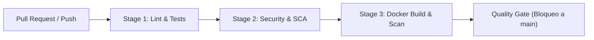

# Preparación para Integración Continua y Despliegue Continuo (CI/CD Readiness)
**Proyecto:** Plataforma Subasta  
**Fecha:** 15 de Noviembre de 2026  
**Objetivo:** Proporcionar la base técnica, comandos reproducibles y directrices de control para que el usuario construya de manera autónoma los pipelines de CI/CD en GitHub Actions.

> [!NOTE]
> En estricto apego a las directivas del proyecto, **no se ha implementado ningún workflow automatizado de GitHub Actions**. Esta guía documenta los bloques de construcción, herramientas recomendadas y puertas de enlace (Quality Gates) para que el desarrollador lidere personalmente dicha implementación.

---

## 1. Comandos de Validación Locales y Reproducibles

Todos los comandos siguientes pueden ejecutarse tanto en una máquina de desarrollo local como en un Runner de GitHub Actions (`ubuntu-latest`):

### 1.1. Backend (Spring Boot / Maven)
```bash
# Navegar al directorio backend
cd subasta-backend

# 1. Compilación estricta y empaquetado sin tests
./mvnw clean compile -B

# 2. Ejecución completa de pruebas unitarias y de seguridad
./mvnw test -B

# 3. Empaquetado de artefacto JAR reproducible
./mvnw package -DskipTests -B
```

### 1.2. Frontend (Node.js / Vitest)
```bash
# Navegar al directorio frontend
cd subasta-frontend

# 1. Instalación determinista de dependencias
npm ci

# 2. Ejecución de la suite completa de pruebas unitarias
npm test
```

### 1.3. Validación de Infraestructura (Docker & Compose)
```bash
# Validar sintaxis, referencias e interpolación de variables en docker-compose
docker compose config --quiet

# Construir imágenes de contenedor verificando ausencia de errores en Dockerfile
docker compose build --no-cache
```

---

## 2. Herramientas DevSecOps Recomendadas para el Pipeline

Para construir un pipeline con enfoque DevSecOps (Shift-Left Security), se recomienda incorporar las siguientes herramientas en etapas sucesivas:

### 2.1. Detección de Secretos (Secret Scanning)
- **Herramienta:** **Gitleaks**
- **Comando reproducible:**
  ```bash
  # Escaneo del historial completo de Git en busca de credenciales o tokens expuestos
  docker run --rm -v $(pwd):/path zricethezav/gitleaks:latest detect --source="/path" --verbose
  ```
- **Integración CI:** Acción oficial `gitleaks/gitleaks-action@v2`.

### 2.2. Análisis de Vulnerabilidades en Dependencias (SCA - Software Composition Analysis)
- **Backend (Maven):** **OWASP Dependency-Check**
  - Comando reproducible vía plugin de Maven:
    ```bash
    ./mvnw org.owasp:dependency-check-maven:check -DfailBuildOnCVSS=7.0
    ```
- **Frontend (Node.js):** **npm audit**
  - Comando reproducible:
    ```bash
    npm audit --audit-level=high
    ```
- **Alternativa integral:** **Trivy (Aqua Security)**
  ```bash
  docker run --rm -v /var/run/docker.sock:/var/run/docker.sock -v $(pwd):/root/.cache/ aquasec/trivy:latest fs .
  ```

### 2.3. Análisis Estático de Código (SAST)
- **Herramienta:** **Semgrep** o **SonarCloud**
- **Comando reproducible con Semgrep (gratuito y ligero):**
  ```bash
  docker run --rm -v $(pwd):/src returntocorp/semgrep semgrep scan --config auto /src
  ```

### 2.4. Escaneo de Vulnerabilidades en Imágenes Docker (Container Scanning)
- **Herramienta:** **Trivy**
- **Comando reproducible:**
  ```bash
  # Escanear imagen del backend
  docker run --rm -v /var/run/docker.sock:/var/run/docker.sock aquasec/trivy:latest image desarrollosubasta-backend:latest --severity HIGH,CRITICAL --exit-code 1

  # Escanear imagen del frontend
  docker run --rm -v /var/run/docker.sock:/var/run/docker.sock aquasec/trivy:latest image desarrollosubasta-frontend:latest --severity HIGH,CRITICAL --exit-code 1
  ```

---

## 3. Arquitectura Recomendada para Pipelines de GitHub Actions

Cuando inicies la construcción de tus workflows en `.github/workflows/`, se recomienda organizar el pipeline en tres fases secuenciales:



### Stage 1: Compilación y Pruebas Rápidas (Feedback Inmediato)
- **Objetivo:** Ejecutar en menos de 3 minutos.
- Jobs paralelos:
  1. `test-backend`: Checkout, Setup Java 21, Cache Maven, `./mvnw test`.
  2. `test-frontend`: Checkout, Setup Node 22, Cache npm, `npm ci`, `npm test`.

### Stage 2: Seguridad Estática y Escaneo de Secretos
- Jobs paralelos:
  1. `secret-scan`: Ejecutar Gitleaks sobre los commits del PR.
  2. `dependency-audit`: Ejecutar `npm audit` y OWASP Dependency-Check.

### Stage 3: Construcción y Validación de Contenedores
- Jobs secuenciales tras superar Stages 1 y 2:
  1. `compose-validation`: Ejecutar `docker compose config`.
  2. `docker-build-and-scan`: Construir imágenes con Buildx y escanearlas con Trivy.

---

## 4. Quality Gates: Controles que Deben Bloquear la Integración a `main`

En la configuración de ramas protegidas de GitHub (`Settings > Branches > Branch protection rules > main`):

1. **Requerir que las comprobaciones de estado pasen antes de fusionar:**
   - `test-backend` (Must pass - 0 fallos).
   - `test-frontend` (Must pass - 0 fallos).
   - `secret-scan` (Must pass - 0 secretos detectados).
2. **Requerir aprobación de Pull Request (Code Review):** Mínimo 1 revisión aprobada.
3. **Requerir ramas actualizadas antes de fusionar (Up-to-date branch):** Evita inconsistencias de integración.
4. **Prohibir force push (`git push --force`) y eliminación de ramas principales.**

